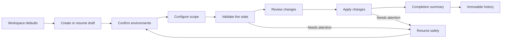

# Dispatch design philosophy and practices

This is the canonical design contract for Dispatch and the starting point for new
Unofficial Box products. It describes how the product should feel, how workflows
should communicate state, and how design work is evaluated before it ships.

The bar is not “does this look polished?” It is: **does the interface make the right
thing obvious, preserve trust, and feel deliberately made rather than assembled from
generic patterns?**

## 1. Comprehension before copy

Do not use labels, helper text, descriptions, or instructions to rescue an unclear
layout. The interface must first communicate context, hierarchy, available actions,
selection, and sequence through its composition.

Design in this order:

1. Spatial grouping and sequence.
2. Shape, contrast, state, and affordance.
3. Familiar controls and direct manipulation.
4. Concise labels that confirm meaning and provide accessible names.
5. Explanatory copy only for risk, exceptions, irreversible consequences, limitations,
   or recovery.

Temporarily hide nonessential copy during review. The user should still recognize:

- where they are;
- what is selected;
- what needs attention;
- what can be acted on;
- what will happen next.

If the workflow stops making sense, improve the composition before adding words.

## 2. Design around the operator's mental model

Every surface should help answer one of these questions:

1. What needs my attention now?
2. Which environments am I operating against?
3. What will change if I continue?
4. What is happening now?
5. What changed, and where can I verify it?

Do not expose internal services, API boundaries, repository paths, or data models unless
they are also meaningful to the operator.

### Keep state honest

Treat these as separate product concepts:

| State | Meaning | Primary location |
| --- | --- | --- |
| Defaults | Starting choices for future work | Settings |
| Draft | Work that has not been validated or applied | Workflow |
| Active | Running, failed, or resumable work | Overview and workflow |
| Completed | An immutable outcome | Summary and history |

A completed operation is never active or resumable. A user's decision and the outcome
that followed are separate facts: **approved does not mean completed**. A successful HTTP
response does not prove the provider operation succeeded. Incomplete results must say so.

The lifecycle is explicit:

The workflow implementation lives in `web/src/App.tsx`, `web/src/workflowResume.ts`, and
the page components under `web/src/pages/`.

## 3. Give every page one job

### Overview

Answer “what should I do next?”

- Lead with active or resumable work.
- When nothing is active, show a clear empty state and one new-work action.
- Show a few operational metrics, not a decorative analytics dashboard.
- Show selected environments for quick context confirmation.
- Link recent deployments directly to immutable historical records.
- Never show completed work in the resumable area.

See `web/src/pages/OverviewPage.tsx`.

### Workflow

- Use a visible, linear path for meaningful prerequisites.
- Allow completed and current steps to be revisited.
- Keep future steps unavailable until prerequisites are satisfied.
- Keep Back and the primary action predictable.
- Preserve drafts across reloads.
- Restore failed work to the stage where the operator can act.
- Use specific actions such as “Review changes” or “Start deployment,” not “Continue.”

See `web/src/components/DeploymentHeader.tsx` and the pages from `ChoosePage.tsx`
through `SummaryPage.tsx`.

### Compare

- Compare live environments when the product claims to compare environments.
- Treat repository or cached-configuration comparison as a separate mode.
- Put changed and missing-from-destination objects first.
- Keep filtering and plan selection visually connected to the results.
- Let the user add and remove deployable objects directly from the list.
- Use a structural tree diff for folders and files; do not show file contents when the
  task is structure-only.
- Use semantic JSON comparison for configuration objects, not escaped strings or a
  screenshot-like representation.

See `web/src/pages/ComparePage.tsx` and `web/src/components/SelectableResourceRow.tsx`.

### Settings

- Keep durable defaults separate from one deployment.
- Show every saved connection, not only the selected connection.
- Keep selection, readiness, reconnect, removal, and opening distinct.
- Do not mix transient run progress into Settings.

See `web/src/pages/SettingsPage.tsx` and `web/src/components/ConnectionDetailsPanel.tsx`.

### History

- Historical records are immutable and read-only.
- Preserve deployment name, systems, strategy, timing, result, environment identity,
  individual resources, and the reviewed change evidence.
- Link every recent deployment directly to its detailed record.
- Show destination actions in provider summaries, not a disconnected global toolbar.

See `web/src/pages/HistoryPage.tsx` and `web/src/components/DeploymentHistoryTable.tsx`.

## 4. Actions belong to the object they affect

Placement communicates scope.

- Put provider Open actions in the provider summary header.
- Put connection management actions on the connection card or row.
- Put comparison-plan actions on the result row.
- Put Review changes next to the change summary.
- Keep one obvious primary action per decision point.
- Use neutral treatments for navigation and destination links.
- Separate destructive actions visually and spatially.

Action labels describe the action, not every identifier:

| Prefer | Avoid |
| --- | --- |
| Open Box | Open Box EID 5105484 |
| Open Salesforce | Open Salesforce org 00D... |
| Review changes | View validated deployment metadata differences |
| Manage | Configure the selected provider connection |

For compact repeated actions, prefer a familiar icon button. Icon-only controls require
an accessible name and usually a tooltip. Use the design system's icon registry rather
than text characters, emoji, or CSS-drawn symbols. A removal action uses the established
round trash-can control; its hover/focus treatment is red.

## 5. Make environment identity recognizable

Present identity in descending order of recognition:

1. Alias or environment name.
2. Tenant hostname or recognizable subdomain.
3. Acting user identity, when useful.
4. Environment type: production, sandbox, scratch org, enterprise, or user.
5. Technical ID as supporting audit detail.
6. Readiness or verification state.

Salesforce My Domain is more recognizable than an organization ID. A Box custom
`*.app.box.com` hostname is more recognizable than an enterprise ID. Technical IDs
belong in supporting details, not primary button labels.

Selected and ready are different states. Recheck live readiness when a page uses a
connection; do not present the last known result as current truth.

Browser-facing identity is sanitized. Never expose tokens, secrets, authorization codes,
raw provider responses, or URLs containing credentials. Connection models and refresh
behavior live in `web/src/connectionReadiness.ts`, `web/src/connectionRefresh.ts`, and
the local API.

## 6. Show change evidence before and after execution

“Validation passed” is not enough. The operator must see what will change.

Capture one bounded, credential-free comparison snapshot during validation and reuse it:

1. Before deployment, when the operator authorizes the change.
2. On the completion summary.
3. In immutable history.

Do not recompute a different story after deployment.

Use a familiar Git-like split or unified diff:

- label both sides in domain language;
- distinguish added, changed, equal, source-only, and destination-only objects;
- show one large component at a time with a visible object list;
- preserve valid structured data;
- omit unchanged, binary, secret, and unbounded content;
- state “Change preview not recorded” for legacy records instead of implying no change.

Only offer Review changes when real preview evidence exists. See
`web/src/components/ValidationChangesDrawer.tsx` and `web/src/pages/ReviewPage.tsx`.

## 7. Prefer structure over prose

Render information as the structure it represents:

- tables for repeated records;
- label/value lists for facts;
- icon + status word + reason for verdicts;
- timelines or traces for ordered work;
- lists or trees for resource hierarchy;
- diffs for before/after evidence.

If the server returns preformatted explanatory text for structured data, improve the
contract so the client receives structured fields and machine-readable pointers. Keep
technical detail available, but subordinate it to the actionable result.

Avoid repeated titles, counts, statuses, and identifiers in adjacent regions. Remove
orange or tinted field chips that merely restate what the diff already shows.

## 8. Visual foundations

The visual system should be calm, dense when useful, and predictable.

### Color

Use color by semantic role, never as decoration:

- Mint `#00e581`: primary actions and selection.
- Orange `#ffa300`: waiting, pending, and contextual attention.
- Purple `#8b49cf`: recorded and audit state.
- Blue `#0098ff`: informational state.
- Red: errors and destructive actions.
- Near-black neutral surfaces: shell and navigation.
- Neutral grays: structure, rules, inactive controls, and secondary text.

Use contrast-safe companions on light surfaces, such as mint `#007a4c`, orange
`#7a4a00`, and blue `#0068ad`. Color is always paired with words or a labelled status
glyph. Active navigation uses a lighter neutral background on the dark shell—not a
colored left-edge accent bar.

Theme values and system-preference behavior live in `web/src/theme.ts`,
`web/src/index.css`, and `web/src/App.css`.

### Typography

- Use one type system and one clear scale.
- Use sentence case for headings, buttons, fields, and navigation.
- Keep prose near a 65–75 character reading measure.
- Use tabular numerals for durations, IDs, and metrics.
- Use monospaced text only for truly code-like or immutable values.
- Let long identifiers wrap or copy safely; do not silently destroy exact data.
- Avoid pervasive uppercase eyebrow labels.

### Spacing, surfaces, and elevation

- Use a consistent spacing scale rather than local arbitrary gaps.
- Use whitespace to separate stages and density to communicate related controls.
- Use cards only for bounded objects, not every paragraph.
- Avoid card soup and nested borders.
- Reserve elevation for overlays and real hierarchy.
- Keep borders quiet and selection visible around the entire selectable object.
- Do not use a decorative edge as the only selection indicator.

### Controls

- One button system: consistent sizes, radius, filled primary, and quiet variants.
- One status-glyph family, always paired with specific words.
- One focus-ring treatment.
- One icon vocabulary from Box Open Elements.
- Real buttons perform actions; links navigate.
- Never nest interactive elements.

### Motion

Use motion to explain arrival or a state change, not to decorate.

- Fast: about 120ms.
- Standard: about 200ms.
- Deliberate: about 320ms.
- Ease out; avoid bounce.
- Use small stagger only when it clarifies sequence.
- Provide a global reduced-motion policy that removes nonessential animation.

## 9. Navigation and shell

- Expanded navigation uses a conventional left-aligned icon-and-label row.
- The icon stays on the left and the text on the right.
- Collapsed and expanded states preserve the same information architecture.
- Active state uses a restrained neutral surface, icon contrast, and text contrast.
- Never use a generated-looking colored accent strip on the active item.
- Keep Help and workspace context visually subordinate to primary navigation.
- The shell and sidebar must cover the full document height on long pages.
- Use `overflow: clip` for shell containers when they must not become scroll targets.
- Closed drawers and panels are `inert` and restore focus without scrolling.

See `web/src/components/Sidebar.tsx` and its tests.

## 10. Status, progress, waiting, and failure

These answer different questions:

| Concept | Question | Treatment |
| --- | --- | --- |
| Readiness | Can this environment be used? | Compact labelled status |
| Progress | How far has active work advanced? | Path, progress bar, or live trace |
| Outcome | What was the final result? | Complete or needs-attention result |

Keep badges scarce. Counts, dates, IDs, and ordinary categories are usually plain text.

Every data surface designs these states intentionally:

- Loading: stable skeleton or local spinner without major layout shift.
- Empty: preserve the layout and make the next relevant action obvious.
- Working: show the current step; add elapsed time for waits longer than a moment.
- Partial: identify what completed and what did not.
- Success: transient confirmation plus durable resulting state.
- Error: persistent, specific, inline, and attached to the offending object.
- Stale: show that live verification is required.
- Unavailable: explain missing evidence without pretending nothing changed.

Errors never disappear only because a timer elapsed. Preserve successful prior steps and
provide the next safe action. See `web/src/components/AppToast.tsx`,
`web/src/components/LiveActivityFeed.tsx`, and `web/src/components/RunTimeline.tsx`.

## 11. Responsive behavior is information prioritization

Mobile is not desktop squeezed narrower.

- Collapse multi-column layouts into one readable column.
- Convert secondary rails into drawers.
- Let provider header actions wrap with their provider.
- Convert four metrics into a two-by-two grid.
- Stack form and footer actions when space is limited.
- Give tables and diffs explicit internal scrolling; never overflow the document.
- Give the message or result full width before preserving secondary actions.
- Keep overlays within the viewport.
- Maintain touch-friendly targets.

Test at desktop and at least `390 × 844`. Zero document-level horizontal overflow is the
acceptance criterion; intentional scrolling inside a table, tree, or diff is allowed.

## 12. Accessibility is part of the component contract

- Use semantic landmarks and one logical heading hierarchy.
- Use tables, lists, and definition lists for their real purposes.
- Give tables captions, even when visually hidden.
- Associate fields with visible labels.
- Give every icon-only control an accessible name.
- Expose selected, expanded, pressed, busy, and disabled states programmatically.
- Announce meaningful asynchronous changes without flooding live regions.
- Keep focus visible and restore it predictably after overlays close.
- Make every workflow and management action keyboard accessible.
- Do not communicate state by color alone.
- Respect reduced motion, zoom, long content, and narrow viewports.

Keyboard, focus, and accessibility behavior require component and browser tests; a visual
inspection alone is not proof.

## 13. Reuse the design system before creating primitives

Box Open Elements is the first choice for buttons, icon buttons, badges, drawers, tables,
switches, paths, progress, notifications, formatting, and reusable patterns.

Before building a custom control:

1. Read the library taxonomy: Foundations → Components → Patterns.
2. Check the current release and component documentation.
3. Check existing issues and enhancement plans.
4. Compose existing primitives where possible.
5. If a real gap remains, implement the smallest product-owned composition and file one
   upstream issue with the need, API or behavior, existing module to extend, and working
   example.

Style Web Components through tokens, documented attributes, and public parts. Never reach
into another component's shadow DOM. Product layout remains in Dispatch; reusable behavior
belongs upstream.

See `docs/BOX_OPEN_ELEMENTS_MIGRATION_PLAN.md` and
`docs/BOX_OPEN_ELEMENTS_COMPONENT_GAPS.md`.

## 14. Security and trust are visible design qualities

The browser owns navigation, temporary form state, and presentation. The trusted Go
service owns credentials, provider calls, package assembly, validation, deployment, and
audit persistence.

- Return purpose-built browser models, not raw provider objects.
- Sanitize progress events, errors, and history.
- Show live state as live and cached state as cached.
- Never imply a provider mutation from local validation, a green build, or a merge.
- Require explicit confirmation for destructive or irreversible actions.
- Preserve reviewed evidence and audit identity across execution.

Architecture details live in `docs/WEB_APP_ARCHITECTURE.md`.

## 15. Design and delivery workflow

### Audit before changing code

1. Read the product documentation and run the real application.
2. Capture the main flow in empty, loading, working, success, partial, error, approval,
   long-content, and mobile states.
3. Check desktop and narrow widths, light and dark themes, keyboard-only use, and reduced
   motion.
4. Tie every critique to rendered evidence or source code.
5. Identify what looks generic, generated, noisy, misleading, or unfinished.
6. Check what Box Open Elements already provides.
7. Prioritize findings by user impact and trust, not aesthetic novelty.

### Implement in focused increments

- One coherent problem per pull request.
- Preserve architecture and existing design-system boundaries.
- Add tests for behavior and pure presentation helpers.
- Include before/after evidence for visual changes.
- Do not remove or weaken tests to make a change pass.
- Do not merge merely because the branch is mergeable.

### Critique the result

After implementation, ask:

- What still looks generated?
- Is anything shown twice?
- Does anything compete with the primary action or pending decision?
- Are controls, radii, icons, and statuses genuinely consistent?
- Do waiting, failure, and long-content states still work?
- Is anything over-announced or missing for assistive technology?

Refine repeatedly; a plausible first draft is not the finished design.

## 16. Anti-patterns to remove

- Colored accent bars on rounded cards or active navigation.
- Gradients, sparkle icons, or generic AI ornament used as identity.
- Text characters pretending to be icons.
- Card soup and nested surface borders.
- Pills around ordinary metadata.
- Uppercase eyebrow labels everywhere.
- Helper copy compensating for unclear hierarchy.
- Repeated titles, counts, statuses, and identifiers.
- Global toolbars containing unrelated object actions.
- Opaque IDs used as the primary environment identity.
- Loading or empty states that collapse the layout.
- Timed error messages with no persistent recovery state.
- Dev inspectors, logs, or repository paths in the main product UI.
- Ad hoc icons, button sizes, radii, focus rings, or status vocabularies.
- Custom controls that duplicate the design system.
- Restyling foreign shadow internals.
- Treating approval, validation, HTTP success, merge, and live deployment as equivalent.
- Claiming completion from a build without rendered-browser evidence.

## 17. Pre-ship checklist

### Product and state

- [ ] Defaults, draft, active, completed, and failed states are distinct.
- [ ] The primary flow remains understandable without helper copy.
- [ ] The selected environment is immediately recognizable.
- [ ] Completed work is absent from resumable areas.
- [ ] The operator sees what will change before authorizing it.
- [ ] Summary and history preserve the reviewed evidence.

### Interaction and visual system

- [ ] Each view has one obvious primary action.
- [ ] Actions are attached to the objects they affect.
- [ ] Selection covers the whole selectable object.
- [ ] Buttons, icons, radii, focus, and status treatments are consistent.
- [ ] Color is semantic and never the only state signal.
- [ ] Loading, empty, working, partial, stale, error, and unavailable states are designed.

### Responsive and accessible behavior

- [ ] Desktop and `390px`-class layouts are usable.
- [ ] Light and dark themes preserve contrast and hierarchy.
- [ ] There is no document-level horizontal overflow.
- [ ] Keyboard order, focus return, and overlay dismissal work.
- [ ] Headings, landmarks, labels, captions, and live regions are correct.
- [ ] Reduced motion is respected.

### Evidence

- [ ] Unit and component tests pass.
- [ ] Frontend lint and production build pass.
- [ ] Backend format, build, vet, and tests pass when contracts changed.
- [ ] The primary end-to-end workflow passes against deterministic state.
- [ ] The embedded application was rebuilt, restarted, and refreshed.
- [ ] Desktop and narrow screenshots were reviewed.
- [ ] Browser console and relevant accessibility checks are clean.
- [ ] Local code, PR, merge, and live-provider states are reported separately.

## Related guidance

- `docs/DESIGN_BEST_PRACTICES.md` — extended operational UI guidance.
- `docs/UX_AUDIT_REMEDIATION.md` — prior audit decisions and remediation boundaries.
- `docs/BOX_OPEN_ELEMENTS_MIGRATION_PLAN.md` — component adoption strategy.
- `docs/BOX_OPEN_ELEMENTS_COMPONENT_GAPS.md` — upstream gaps and enhancement tracking.
- `docs/WEB_APP_ARCHITECTURE.md` — browser/local-service responsibility boundary.
